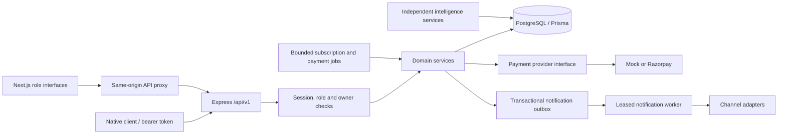

# Architecture decisions

Context for choices that are not obvious from reading the code, and the rules
any new module is expected to follow.

---

## 1. A standalone API, not a Next.js-only app

Next.js route handlers could have hosted the backend. They were not used,
because three of the seven roles will not be served by this web app for long:

- **Delivery partners** need a mobile app (offline manifests, GPS at
  proof-of-delivery, push notifications).
- **Vendors** often run a kitchen display on a tablet.
- **Institutions** will want a reporting integration.

A REST API at `/api/v1` makes every client a peer. The web app is simply the
first one, and it holds no business logic that another client would have to
reimplement.

## 2. The browser never talks to the API directly

`apps/web/src/app/api/[...path]/route.ts` proxies browser calls to the API.

This exists so session cookies are **first-party**. If the browser called
`localhost:4000` from a page on `localhost:3000`, those cookies would be
cross-site — requiring `SameSite=None; Secure`, subject to third-party-cookie
restrictions, and in practice pushing teams toward keeping the token in
`localStorage` where any XSS can read it.

With the proxy, both auth cookies are `httpOnly` and page JavaScript cannot
read them. The API's address also never reaches the client bundle.

The proxy is a dumb pipe. Business logic must not accumulate in it.

## 3. Money

Stored as `Decimal(10,2)` in Postgres, crossing the wire as a **decimal string**
(`"149.50"`). Arithmetic is done in integer paise via `toMinorUnits` /
`fromMinorUnits` in `@lunch/shared`.

Never use a JavaScript `number` for an amount. `0.1 + 0.2 !== 0.3`, and a
rounding error in a payment total is not a bug you find in testing — it is one a
customer finds in a receipt.

## 4. Time

Time slots store **minutes from midnight** (`startMinute`, `endMinute`) in the
city's timezone, not timestamps.

A 12:30 lunch slot is 12:30 *local*, on every date, across DST boundaries and in
every city. Storing a timestamp would require recomputing it per date and per
zone. Cutoffs are also minutes (`orderCutoffMinutes` before the slot starts).
`slotInstant` converts the city-local start to a UTC instant before comparing it
with the current time; treating local minutes as UTC would close ordering late.

`serviceDate` is a Postgres `DATE`. A delivery happens on a calendar day, not at
an instant.

## 5. `MealSchedule` is the sellable unit

A `Meal` is a vendor's menu definition and is **not purchasable**. A
`MealSchedule` — meal × kitchen × date × time slot, with a price and a quantity
— is what a customer actually buys.

This one table answers "what can I order for next Tuesday's lunch at this
checkpoint?" with a single indexed query, enforces per-kitchen capacity, and
accumulates exactly the history a demand-prediction model would later need. No
new table is required for any of it.

Stock is `totalQuantity - reservedQuantity`. `reservedQuantity` is incremented
inside the same transaction that creates the order, under the row lock, so two
parents cannot both take the last tiffin.

Checkpoint delivery windows reuse `TimeSlot` and `CheckpointTimeSlot`: the
former defines local start/end/cutoff times, while the latter enables a slot at
a checkpoint and may override its capacity and cutoff. `MealSchedule` supplies
the delivery date and kitchen association. Customer availability combines
these records and reports checkpoint-window capacity after committed,
non-cancelled `OrderItem` quantities are counted.

Checkout must call `assertDeliverySlotCapacity` inside the same database
transaction that creates its `OrderItem` rows. The helper locks the
`CheckpointTimeSlot` row before counting existing items, so concurrent checkouts
for the same checkpoint/date/slot serialize. Subscriptions already store the
same `checkpointId` and `timeSlotId`; their generated dated order items can use
the same guard without a second scheduling model.

## 6. Fulfilment state lives on `OrderItem`

An order can span several dates, checkpoints and beneficiaries: a parent buying
a week of lunches for two children at two different schools is **one checkout**.

The kitchen prepares, and the rider delivers, *one meal for one person on one
date*. So `OrderItemStatus` is the real workflow and `OrderStatus` is a roll-up
derived from it. `orders/order-state.ts` is the single fulfilment roll-up. Every transition writes
`OrderItem` and the persisted `Order.status` together while holding the order
lock. Customer, admin, analytics and list filters read that same stored status;
no read endpoint independently derives a different answer. Mixed terminal items
become `PARTIALLY_FULFILLED`; a failed line does not prevent remaining funded
lines from progressing. Checkout/payment states remain authoritative until
verified capture or explicit corporate credit authorization.

`OrderItem` also snapshots `mealNameSnapshot`, `unitPrice` and
`beneficiaryName`, so a past order never changes when a vendor edits their menu
or a child record is removed.

## 7. Refresh-token rotation with leak detection

Access tokens are 15-minute JWTs bound to a database session by `sid`. Every
request verifies the current user and an unrevoked, unexpired session. Refresh tokens are opaque random strings; only
their SHA-256 hash is stored, so a database leak cannot be replayed as a
session.

Each use rotates the token: the old row is revoked and points at its successor
via `replacedById`. **Presenting an already-rotated token means it leaked** —
either the attacker or the legitimate user is replaying it — so every refresh
token for that user is revoked and all devices must sign in again.

SHA-256 rather than bcrypt is deliberate: these are high-entropy random values
with nothing to brute-force, and they are verified on every refresh where a slow
KDF would be a liability. Passwords use bcrypt, because they are low-entropy and
chosen by humans.

### Why `authenticate` still hits the database

The signed subject identifies the user; `status`, `role`, and the token’s
session are re-read on every request. A suspended account must lose access immediately, not whenever its
15-minute token happens to expire. A role change takes effect at once for the
same reason.

## 8. Validation schemas are shared, not duplicated

`@lunch/shared` holds the Zod schemas, and both sides import them: the API via
`validateBody`, the web forms by calling `safeParse` before submitting.

The client-side check is a convenience — it avoids a round-trip and shows the
same wording. **The server-side check is the guarantee.** A client can be
bypassed; the API validates every request regardless.

The package is built as **dual CJS/ESM**. The API is CommonJS; Next.js needs ESM
for client components. A CJS-only build breaks Next's client-component pipeline,
so relative imports in the package carry explicit `.js` extensions and each
output directory is stamped with its module type.

## 9. Enums are declared twice, on purpose

Once as Prisma enums in `schema.prisma`, once as `as const` objects in
`@lunch/shared`. Prisma's generated types cannot be imported by the browser
bundle, and the shared package must run in both.

They must be kept in lockstep. Both files say so at the top. A generator could
remove the duplication and is worth adding if the enum set grows much.

## 10. Errors

Services throw `AppError` (with an HTTP status and a stable `ErrorCode`);
`middleware/error-handler.ts` is the single place one becomes a response.

Anything else thrown is treated as a bug: logged with its stack and reported as
a generic 500, so an internal detail never reaches a client. Prisma errors are
mapped explicitly — a unique-constraint violation is a `409`, not a `500`.

Clients switch on `error.code`. Messages are for humans and may be reworded or
localised at any time.

---

## Conventions for a new module

1. **Inspect first.** Reuse `core/`, `middleware/` and the UI primitives in
   `apps/web/src/components/ui`. Do not add a second way to do something that
   already has one.
2. **Layer it.** `routes` declares URL + schema + roles; `controller` adapts
   HTTP; `service` holds the rules and does not import Express.
3. **Validate at the edge.** A Zod schema in `@lunch/shared`, applied with
   `validateBody` / `validateQuery` / `validateParams`.
4. **Authorize explicitly.** Every non-public route names its roles. `SUPER_ADMIN`
   is not implicitly allowed everywhere.
5. **Migrate narrowly.** One migration per module, covering only what the module
   needs.
6. **Handle all four states** in the UI: loading, error, empty, and populated.
   Use the shared components in `components/ui/States.tsx`.
7. **Keep it runnable.** The application must start, typecheck, build and pass
   its tests at the end of every module.

## Module 21: integrated runtime and ownership

| Boundary | Contract |
| --- | --- |
| Catalog → cart → checkout | A published `MealSchedule` is the sellable unit. The server revalidates beneficiary ownership, checkpoint/window, stock, cutoff and capacities. Dates remain calendar dates; cutoffs convert the city-local window to an instant with `slotInstant`. |
| Consumer / subscription / corporate → orders | These create the same Order/OrderItem records. Subscriptions generate a bounded horizon; corporate charges reserve approved credits without fabricating provider payments. |
| Orders → payment → fulfilment | Consumer/co-paid orders await backend-verified capture. Fully funded corporate orders use a validated durable credit authorization. `assertOrderPaid` gates writes; its SQL equivalent admits the same funding states to kitchen lists. |
| Kitchen → route → rider | Preparation changes the same items shown by customer/admin. Route creation assigns packed items and ordered checkpoint stops transactionally; only the assigned active rider may pick up, start, arrive, or complete them. |
| OTP → confirmation | Customer-issued delivery codes are verified on the backend. Delivery state and notification enqueueing commit together. Retries cannot send a second logical delivery confirmation. |
| Admin / institution / corporate | Central role guards plus service ownership scopes apply. Administrative state changes use revisions/expected status and audit records; institution/company membership is not inferred from a client-supplied ID. |
| Reporting / intelligence | Scoped readers of persisted domain records. Recommendations do not mutate orders. Support retrieves verified records and does not infer payment or delivery success. |

API responses retain `{data}` and paginated `{data, meta}` envelopes. Browser
forms use the shared API client and error mapping; server pages use `getWithMeta`
when they need pagination. Compatibility aliases `/orders/history` and
`POST /orders` share the canonical handlers instead of duplicating logic.
Vendor item APIs remain for existing clients; kitchen batch APIs provide scoped
operational lists, audited batches and partial-batch outcomes.

The API process starts bounded subscription generation, payment reconciliation,
and notification dispatch workers and drains them at shutdown. These are not
unlimited recurring order generators. External transport failures do not undo
an accepted business transaction; durable records support reconciliation/retry.

Browser checkout retains its request key in session storage scoped to the cart.
A lost response can be recovered after reloading without creating a second order.
Only the request key is stored there; authentication tokens remain HttpOnly.
Operational pages reload authoritative data after mutations; refresh controls or
page reload fetch changes made by another persona. This is not a realtime push
subscription to every dashboard.

Run `npm run db:verify` to replay migrations in a disposable local database and
compare both fresh and current databases with Prisma. Run the integration gate
with `npm run test:integration`; run the full suite and production build before
`npm run test:browser`. Database-writing suites must run sequentially. See
[Module 21 verification and blockers](module-21-integration.md) for exact evidence.

Historical records can be checked/repaired with `npm run db:reconcile-order-status`
(dry-run default; `-- --apply` to write). Each invocation handles at most 100
records, locks and re-reads each order, preserves terminal financial states, and
records an audit event for each correction. Continue with the returned cursor.
This is explicit maintenance, not an unbounded worker or a read-time mutation.
